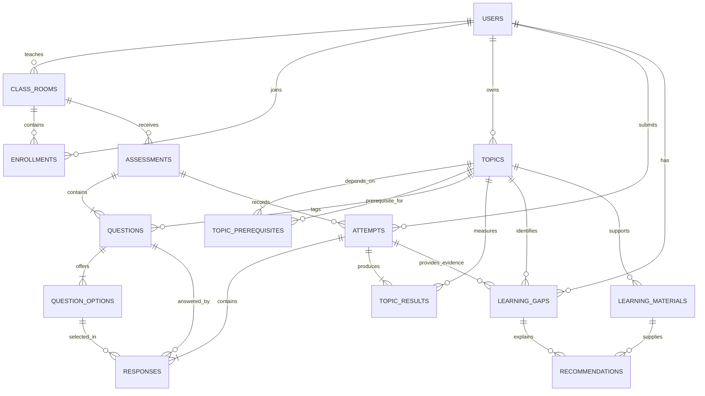

# Database schema

JPA is the source of truth. The application creates/updates tables at startup using `spring.jpa.hibernate.ddl-auto=update`. `schema.mysql.sql` is generated from these same mappings using Hibernate's MySQL dialect; it is supplied for inspection or fresh-database initialization. It is not an incremental migration for an existing database.

Every entity uses an auto-increment `BIGINT` primary key. JPA manages foreign keys and join tables. Enum values are stored as strings. Times are stored from UTC `Instant` values; the UI formats them in the viewer's local time zone.

| Table | Main fields | Relationships / constraints |
|---|---|---|
| `users` | id, name, email, password_hash, role | Unique email; roles STUDENT / TEACHER |
| `class_rooms` | id, name, join_code, teacher_id | Teacher → many classes; unique join code |
| `enrollments` | class_room_id, student_id | Unique class/student pair; many-to-many enrollment |
| `topics` | id, name, description, teacher_id | Curriculum owned by one teacher |
| `topic_prerequisites` | topic_id, prerequisite_id | Topic self-reference; service rejects cycles and cross-owner links |
| `assessments` | id, title, class_room_id, created_by_id, mini_quiz, topic_id, published, archived, version | Assigned to one class; topic required for mini-quizzes |
| `questions` | id, assessment_id, topic_id, difficulty, text, explanation | Each question belongs to one assessment and topic |
| `question_options` | id, question_id, text, correct | Two to six options; service requires exactly one correct option |
| `attempts` | id, assessment_id, student_id, submitted_at, total_score, submission_key, payload_hash | Unique student/submission_key; repeated attempts allowed with new keys |
| `responses` | id, attempt_id, question_id, selected_option_id, correct, confidence_level | Unique attempt/question; service verifies option membership |
| `topic_results` | id, attempt_id, topic_id, score_percent, mastery_level | Unique attempt/topic; historical result snapshots |
| `learning_gaps` | id, student_id, topic_id, attempt_id, gap_type, status | DIRECT / ROOT / MISCONCEPTION; current gap evidence updated to latest relevant result |
| `learning_materials` | id, topic_id, title, type, url_or_content, archived | LESSON / PRACTICE / VIDEO / LINK |
| `recommendations` | id, student_id, gap_id, material_id, explanation, order_index, status | Ordered materials; PENDING / DONE / RESOLVED |

## Relationship diagram

## Data integrity decisions

- A pessimistic lock on the student row serializes submissions and study-path refreshes for that student. A unique database key independently protects attempt identity.
- Assessment edits and submissions lock the assessment row. Questions cannot change after any saved attempt.
- Topic graph edits lock the owning teacher row so simultaneous graph updates cannot introduce a cycle between otherwise valid individual edits.
- Current gap and recommendation rows may be refreshed, but historical attempts, responses, and topic results remain intact.
- Deleting an attempted assessment archives it. Deleting a material archives it. Referenced topics are protected by foreign keys.
- The default schema-generation strategy is suitable for a classroom project. For ongoing production releases, replace `update` with reviewed, versioned migrations.
