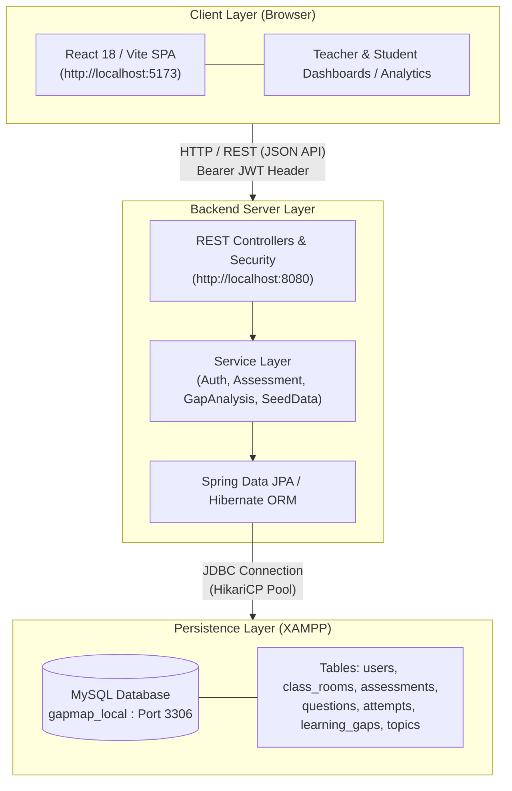

# GapMap System Architecture

## 1. System Overview
GapMap utilizes a decoupled Client-Server architecture separating user interface logic from business processing and data persistence:

* **Frontend Client:** React 18 single-page application (SPA) built with Vite, providing real-time responsive dashboards for students and teachers.
* **Backend REST Service:** Java Spring Boot 3.4.5 application delivering RESTful APIs, business logic processing, automated scoring, and JWT security controls.
* **Database Layer:** MySQL relational database hosted locally via XAMPP Control Panel, managing persistent system entities, user credentials, assessment content, and performance tracking.

---

## 2. System Architecture Diagram

## 3. Technology Stack Specifications

### Frontend Application Layer
* **Framework:** React 18 with Vite build tooling
* **State Management & Routing:** React Context API, React Router DOM
* **Styling & UI:** Tailwind CSS, Custom CSS components
* **Data Visualization:** Recharts
* **API Integration:** Axios client configured with base URL `http://localhost:8080`
* **Port:** `5173`

### Backend Application Layer
* **Framework:** Spring Boot 3.4.5 (Java 25 runtime environment)
* **Security & Auth:** Spring Security with Nimbus OAuth2 JWT implementation (`app.jwt-secret`)
* **Persistence Layer:** Spring Data JPA with Hibernate ORM core 6.6.13
* **Connection Pooling:** HikariCP
* **Build Tool:** Apache Maven
* **Port:** `8080`

### Database Persistence Layer
* **Engine:** MySQL 5.7+ / 8.0+ running via XAMPP Control Panel
* **Database Name:** `gapmap_local`
* **Initialization Script:** `docs/schema.mysql.sql`
* **User Credentials:** User `root` with no password (XAMPP default configuration)
* **Port:** `3306`

---

## 4. Key Subsystem Workflows

### 1. Authentication & Security Workflow
1. Client submits credentials to `/api/auth/login`.
2. Backend authenticates user details against hashed passwords in the `users` table.
3. Upon validation, the server generates a signed JSON Web Token (JWT).
4. The client stores the JWT and appends it as an `Authorization: Bearer <token>` header on subsequent REST API calls.

### 2. Assessment & Gap Analysis Workflow
1. Enrolled students retrieve assigned mini-quizzes from `/api/assessments`.
2. Upon submission, the backend evaluates student responses against correct `question_options`.
3. Total percentage scores are calculated and saved to the `attempts` table.
4. Topics scoring below configured mastery levels (`app.mastery.developing=50`) automatically trigger entry creation in the `learning_gaps` table.
5. `learning_gaps` entries are mapped to `learning_materials` rows to return personalized review links to the student dashboard.

### 3. Automatic Data Seeding Workflow
1. During startup, `com.gapmap.config.SeedData` evaluates database conditions.
2. If `app.seed=true` and `userRepository.count() == 0`, the seed runner populates initial demo users, topics, quizzes, questions, and learning materials into MySQL.